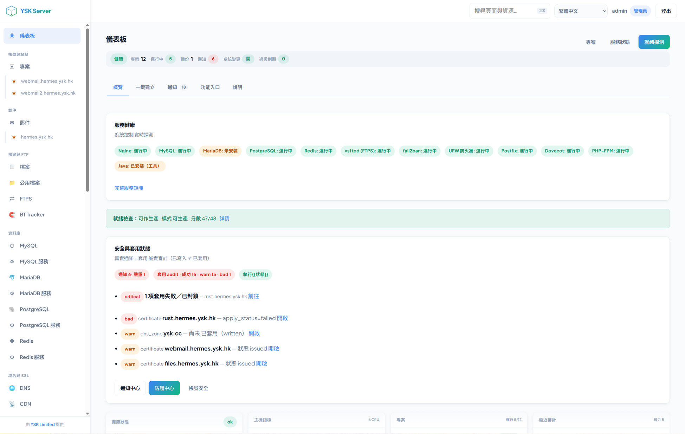
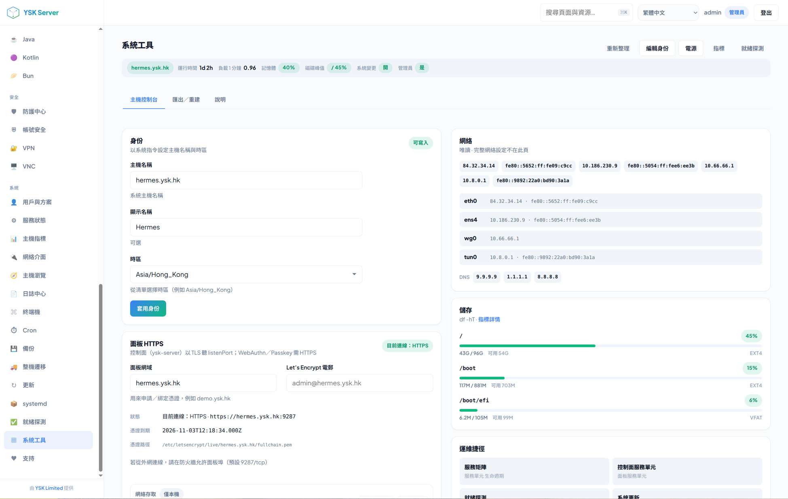

<p align="center">
  
</p>

<h1 align="center">YSK Server</h1>

<p align="center">
  <strong>給你自己主機用的 Linux 控制平面。</strong><br />
  網頁面板、CLI 與 API — 在一台 VPS 或實體機上管理網站、電郵、資料、邊緣與防護。
</p>

<p align="center">
  <a href="./README.md">English</a>
  ·
  <a href="https://ysk.hk/products/ysk-server">產品頁</a>
  ·
  <a href="https://ysk.hk/">ysk.hk</a>
  ·
  <a href="mailto:email@ysk.hk">email@ysk.hk</a>
  ·
  <a href="https://www.npmjs.com/package/ysk-server">npm</a>
</p>

<p align="center">
  <a href="https://www.npmjs.com/package/ysk-server"></a>
  <a href="https://github.com/yanshekki/ysk-server/actions/workflows/ci.yml"></a>
  
  
  
</p>

> 語言：**中文（香港書面語）** · [English](./README.md)

免費、開源、**單機**。不是多租戶面板即服務。你把它裝在自己的機器上；介面、`ysk-server` CLI 與 HTTP API 共用同一核心 — 亦適合 AI agent。

## 為什麼

| 主機屬於你 | 同一控制平面 | 誠實套用 | 生產堆疊 |
|:-----------|:-------------|:---------|:---------|
| 你操作的一台 Linux — VPS 或實體機 | 面板、CLI 與 API 同一模型 | 改主機需要 **root** + `YSK_EXECUTE=1`。預演不會報成功 | 網站、電郵、資料庫、DNS／SSL、防護、Docker |

## 1.1.31 新內容

### 修正
- 從源碼跑 `install.sh` 時不再把已發布的 npm tarball overlay 到 git 目錄。先前會用沒有 `maxmind` 等 core 執行時依賴的 bundled 副本取代 pnpm 的 `ysk-server-core` 連結，`ysk-server setup` 就崩潰。Overlay（`--upgrade`／面板自我更新）而家會複製 tarball 入面所有 `node_modules` 項目，再跑 `npm install --omit=dev`，等 flattened 傳遞依賴可以解析。

### 內部／CI
- 本頁只保留最近三個版本。
- **套件** — `ysk-server`、`ysk-server-shared`、`ysk-server-core` 一齊出 **1.1.31**。
- Build & test 會用從源碼佈局解析 core 執行時依賴（`pnpm test:runtime-deps`）。

## 1.1.30 新內容

### 安全
- 每週供應鏈檢查。新的高嚴重性 `happy-dom`（GHSA-834v-8h66-3h79）釘到 **21.0.4**。經 `bittorrent-tracker` 的殘餘 `ip@2.0.1` 沒有變（上游沒有修補版）。報告：[docs/security/2026-10-25-supply-chain-ZH.md](docs/security/2026-10-25-supply-chain-ZH.md)。

### 依賴升級
- Vite **6.4.5**、`sql.js` **1.15.1**、happy-dom **21.0.4**。覆寫：`ip-address` **10.7.5**、happy-dom **21.0.4**。pnpm 維持 **9.15.9**。

### 內部／CI
- 本頁只保留最近三個版本。
- **套件** — `ysk-server`、`ysk-server-shared`、`ysk-server-core` 一齊出 **1.1.30**。

## 1.1.29 新內容

### 安全
- 每週供應鏈檢查。經 `bittorrent-tracker` 的殘餘 `ip@2.0.1` 沒有變（上游沒有修補版）。報告：[docs/security/2026-10-18-supply-chain-ZH.md](docs/security/2026-10-18-supply-chain-ZH.md)。

### 依賴升級
- Vitest **4.1.12**、`playwright-core` **1.64.1**、`sql.js` **1.15.0**、`@testing-library/user-event` **14.6.8**。覆寫：nanoid 3.x **3.3.20**、`ip-address` **10.7.4**。tsx 的 esbuild **0.28.2**。pnpm 維持 **9.15.9**。

### 內部／CI
- 本頁只保留最近三個版本。
- **套件** — `ysk-server`、`ysk-server-shared`、`ysk-server-core` 一齊出 **1.1.29**。

[完整變更紀錄](./CHANGELOG.zh.md)

## 面板

<p align="center">
  
</p>
<p align="center"><sub>儀表板 — 即時服務健康、就緒檢查與套用誠實度</sub></p>

<p align="center">
  
</p>
<p align="center"><sub>系統工具 — 身份、面板 HTTPS、網絡與儲存</sub></p>

## 安裝

建議 **Ubuntu 22.04／24.04／26.04**，以 **root** 執行。其他 Linux：盡力支援。

### 建議做法

```bash
curl -fsSL https://raw.githubusercontent.com/yanshekki/ysk-server/main/install.sh | bash -s -- --non-interactive
```

`install.sh` 會寫入 systemd 單元、啟動 TLS，並**一次性**打印管理員密碼。

### 安裝之後

1. 開啟 **`https://<伺服器IP>:9287`**（首次請接受自簽憑證警告）。
2. 以安裝結尾的帳密登入（亦寫在 `$dataDir/BOOTSTRAP-CREDENTIALS.txt`）。
3. 更改密碼。啟用 2FA。
4. 有域名後，為面板簽發受信任憑證。

### 其他方式

```bash
npm install -g ysk-server
sudo ysk-server setup --admin-user admin --admin-password 'YourStrongPass1!' --data-dir /var/lib/ysk-server
export YSK_EXECUTE=1
sudo ysk-server serve
```

預設弱密碼 `admin` 會被拒絕。全新主機請優先使用 `install.sh`。

```bash
git clone https://github.com/yanshekki/ysk-server.git
cd ysk-server
sudo ./install.sh
```

### 卸載

```bash
sudo ./uninstall.sh --all --keep-data --yes
# 連已登記資料一併清除：
sudo ./uninstall.sh --all --purge-data --yes
```

說明：[安裝](docs/getting-started/install-ZH.md) · [卸載](docs/getting-started/uninstall-ZH.md) · [文件目錄](docs/INDEX-ZH.md)

## 功能

| 範疇 | 已交付 |
|:-----|:-------|
| **網站** | 專案、Git 部署、逐站隔離 |
| **檔案** | 檔案管理、公開分享、WebDAV、FTPS、BT Tracker／WebTorrent |
| **電郵** | 網域、郵箱、投遞檢查（不保證全球入匣） |
| **資料** | MySQL、MariaDB、PostgreSQL、Redis |
| **邊緣** | DNS、SSL、Nginx、Apache、CDN agents |
| **安全** | 防護、SSH／2FA、VPN、VNC |
| **容器** | Docker 引擎 |
| **運維** | 指標、日誌、終端、cron、備份、更新 |
| **驗證者** | L1 節點（Beta） |

## CLI

```bash
ysk-server readiness --json
ysk-server help --locale zh-HK
export YSK_EXECUTE=1    # 真正改主機時必須
```

[CLI 參考](docs/cli/reference-ZH.md) · [agent 命令](docs/agent/commands.json) · [agent skill](.grok/skills/ysk-server/SKILL.md)

## 誠實說明

- 安裝面板**不等於**全球電郵入匣已保證。DNS、PTR 與 25 埠仍須自行處理。
- 危險主機操作維持**預演**，直至 `YSK_EXECUTE=1`。被阻擋的結果不是成功。
- 首次面板憑證為自簽。主機有域名後，請改用 Let’s Encrypt（或你自己的憑證）。

## 支援

YSK Server **免費**。若對你有幫助：

- 面板 **Support**（`/support`）— 作者、贊助、加密貨幣地址
- [Linktree](https://linktr.ee/yanshekki) · GitHub Sponsors
- 加密貨幣：`yanshekki.eth`（EVM）· `yanshekki.near` · `$yanshekki`（ADA）
- 需要代為操作： **YSK Limited** — 請來信（本頁不標價）
- 問題與回報：[email@ysk.hk](mailto:email@ysk.hk) · [Issues](https://github.com/yanshekki/ysk-server/issues) · [Discussions](https://github.com/yanshekki/ysk-server/discussions)
- 法律文件：[使用條款](./docs/legal/terms-ZH.md) · [私隱政策](./docs/legal/privacy-ZH.md) · [免責聲明](./docs/legal/disclaimer-ZH.md)（面板 `/legal`）

## 開發

```bash
pnpm install && pnpm build
pnpm --filter ysk-server exec node --import tsx/esm src/cli.ts setup --data-dir .ysk --json
pnpm --filter ysk-server exec node --import tsx/esm src/cli.ts serve --data-dir .ysk
```

架構與貢獻說明見 **[docs/](docs/INDEX-ZH.md)** 與 **[CONTRIBUTING-ZH.md](./CONTRIBUTING-ZH.md)**。

---

<p align="center">
  <strong>YSK Server</strong> · 掌控自己的主機 ·
  <a href="https://ysk.hk/products/ysk-server">產品頁</a> ·
  <a href="https://ysk.hk/">ysk.hk</a> ·
  <a href="mailto:email@ysk.hk">email@ysk.hk</a>
</p>
